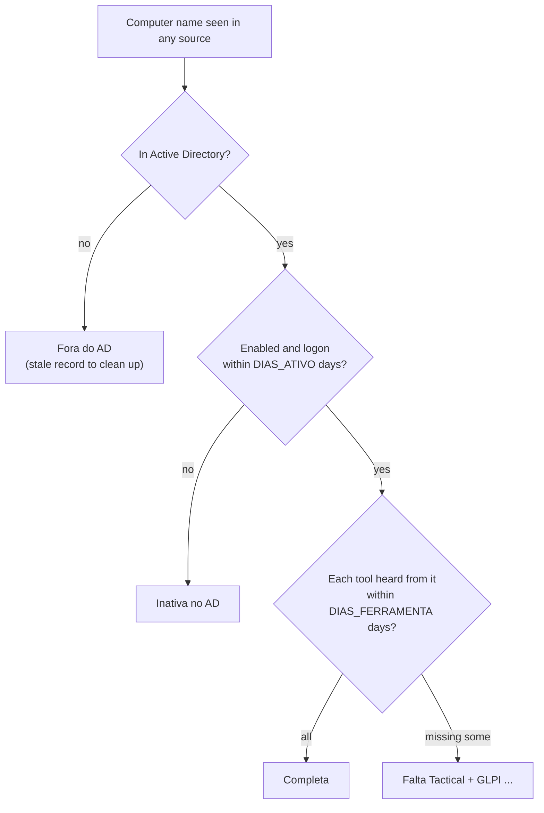

# Fleet Coverage Dashboard

[](https://github.com/bisquilha/fleet-coverage-dashboard/actions/workflows/tests.yml)

> Every computer in the domain should have the RMM agent, the inventory agent and the antivirus. Which ones don't?

A small Python collector that answers that question every 10 minutes. It uses **Active Directory as the source of truth** and joins, by computer name, what three management tools know about each machine:

| Source | What it brings |
|---|---|
| **Active Directory** (LDAP) | last logon, OS, OU, account enabled |
| **Tactical RMM** (REST) | agent last contact, logged-in user, IP, serial, model |
| **GLPI** (REST) | inventory agent last report, asset state, entity, duplicate records |
| **Kaspersky Security Center** (OpenAPI, optional) | agent contact, antivirus installed, real-time protection on |

The result goes to **InfluxDB** and two **Grafana** dashboards:

- **TV dashboard:** coverage per tool and per site, plus the lists of machines missing each tool. Built to stay on a wall screen; it shows no users or IPs.
- **Detail dashboard (IT only):** one row per machine with every field, filterable by site and type.

Built and running in production at a multi-site company. This is a generic, sanitised version: no company names, hosts, IPs or credentials.

---

## How a machine is classified



Details that matter in real environments:

- AD `lastLogonTimestamp` (FILETIME), ISO dates from the RMM and the antivirus, and GLPI local times without a time zone are all normalised.
- Duplicate records (re-installed agents, cloned names) keep the most recent entry; GLPI duplicates are counted so they can be merged.
- Servers are detected by OS, OU or RMM monitoring type and kept apart from workstations.
- The site comes from the naming convention `PREFIX-SITE-NNN`, falling back to the GLPI entity name.
- **No partial writes:** if any source fails, nothing is written and the dashboards keep the last good collection. A `parque_coleta` record shows the error.
- Every source is accessed **read-only**.

## Repository layout

```
src/        fleet_collector.py (collector), ksc_client.py (minimal Kaspersky Security Center OpenAPI client)
grafana/    TV and detail dashboards (InfluxDB datasource variable)
tools/      dashboard generator (dashboards are generated, not hand-edited)
deploy/     example config, systemd service and timer (every 10 min)
tests/      unit tests for the join and classification logic
```

## Quick start

```bash
pip install -r requirements.txt
install -d /opt/parque-coletor && install -m 755 src/*.py /opt/parque-coletor/
install -m 600 deploy/parque-coletor.conf.example /etc/parque-coletor.conf   # then edit it
python3 /opt/parque-coletor/fleet_collector.py --teste    # collects and prints a summary, writes nothing
cp deploy/parque-coletor.{service,timer} /etc/systemd/system/ && systemctl enable --now parque-coletor.timer
```

Create the InfluxDB 1.8 database (`CREATE DATABASE parque WITH DURATION 90d`), add it to Grafana as a datasource and import the two dashboards from `grafana/`.

## Tests

```bash
pip install requests
python tests/test_fleet_collector.py
python tools/gen_dashboards.py /tmp/out   # regenerates the dashboards (identical to grafana/)
```

## Tech

Python 3 · LDAP (ldap3) · Tactical RMM API · GLPI REST API · Kaspersky Security Center OpenAPI · InfluxDB 1.8 · Grafana · systemd timers

---

## Resumo em português

Coletor em Python que usa o **AD como base** e confere, máquina por máquina, se cada computador ativo tem:
- o agente do **Tactical RMM**;
- o **GLPI Agent**;
- o **antivírus** (Kaspersky, opcional).

Mostra a cobertura por unidade num painel de TV do Grafana, sem usuários nem IPs, e num painel de detalhe só para a TI. Também aponta o "lixo" (máquinas nas ferramentas que não existem mais no AD) e os cadastros duplicados no GLPI. Usado em produção numa empresa com várias unidades; esta é uma versão genérica, sem dados da empresa.

## License

[MIT](LICENSE)
